# 🚗 CarMaintenance

<p align="center">
  
  
  
  
  
</p>

---

## 📌 Cos'è questo progetto

CarMaintenance records vehicle maintenance and presents a dashboard for browsing history, costs, and reminders. The server-rendered workflow routes browser requests through Express to maintenance handlers, validates submissions, persists MongoDB-backed records, and renders Pug pages or JSON. Production also supports a browser-local storage mode with CRUD, statistics, filtering, and export; that client-side branch is documented and represented by its JavaScript modules, though their internal call wiring was not sampled. The diagram focuses on relationships evidenced by excerpts or README; client-side connections are left unverified.

---

La modalità di archiviazione è selezionata automaticamente dall'ambiente:

1. **Sviluppo e test**:
   * Utilizza il backend Node.js / Express con **MongoDB** e **Mongoose ORM**.
   * Connessione centralizzata in `config/database.js` con mascheramento credenziali nei log e supporto a database di test isolati (`carmaintenance_test`).
2. **Produzione**:
   * **Zero dipendenze esterne**: tutti i dati vengono archiviati e gestiti direttamente nel browser dell'utente tramite **IndexedDB** (con fallback su `LocalStorage`).
   * Il client esegue CRUD completo, calcolo statistiche, ricerca, filtri ed esportazione interamente in locale.
   * Include un dataset dimostrativo iniziale pronto all'uso al primo avvio.

Non è disponibile un selettore: lo storage non può essere cambiato dal browser. Impostare `NODE_ENV=production` abilita lo storage browser; negli altri ambienti viene utilizzato MongoDB.

---

## Architettura

```mermaid

%% Generated by https://gitdiagram.com/lele97/carmaintenance
flowchart TD

subgraph group_web["Web interface"]
  node_express["Express application<br/>[app.js]"]
  node_dashboard["Dashboard route<br/>[index.js]"]
  node_entry["Add route<br/>[add.js]"]
  node_edit["Update route<br/>[update.js]"]
  node_api["REST API<br/>[api.js]"]
  node_data["Data endpoints<br/>[data.js]"]
  node_delete["Delete route<br/>[delete.js]"]
  node_templates["Pug pages"]
end

subgraph group_domain["Maintenance domain"]
  node_validator["Payload validation<br/>[validator.js]"]
  node_service["Intervention service"]
  node_stats["Stats and reminders"]
  node_model["Intervention schema<br/>[Intervention.js]"]
end

subgraph group_storage["Persistence modes"]
  node_mode["Storage mode selector<br/>[storageMode.js]"]
  node_dbconfig["MongoDB connection<br/>[database.js]"]
  node_mongo[("MongoDB")]
end

subgraph group_client["Browser application"]
  node_dashboardjs["Dashboard interactions<br/>[dashboard.js]"]
  node_localstorage["Browser storage<br/>[storage.js]"]
  node_mileage["Mileage readings<br/>[mileageReadings.js]"]
end

node_driver(("Car owner"))
node_browser(("Browser"))

node_browser -->|"sends requests"| node_express
node_express -->|"routes requests"| node_dashboard
node_express -->|"routes requests"| node_entry
node_express -->|"routes requests"| node_edit
node_express -->|"routes requests"| node_api
node_express -->|"routes requests"| node_data
node_express -->|"routes requests"| node_delete
node_dashboard -->|"queries records"| node_service
node_dashboard -->|"calculates dashboard"| node_stats
node_dashboard -->|"renders dashboard"| node_templates
node_entry -->|"validates input"| node_validator
node_entry -->|"creates records"| node_service
node_entry -->|"renders form"| node_templates
node_edit -->|"validates input"| node_validator
node_edit -->|"reads and updates"| node_service
node_edit -->|"renders edit"| node_templates
node_api -->|"validates input"| node_validator
node_api -->|"manages records"| node_service
node_data -->|"queries records"| node_service
node_data -->|"exports statistics"| node_stats
node_delete -->|"deletes records"| node_service
node_service -->|"queries and writes"| node_model
node_service -->|"checks connection"| node_dbconfig
node_model -.->|"persists records"| node_mongo
node_dashboard -->|"selects mode"| node_mode
node_api -->|"reports mode"| node_mode
node_dbconfig -->|"connects"| node_mongo
node_browser -.->|"uses dashboard"| node_dashboardjs
node_dashboardjs -.->|"uses local CRUD"| node_localstorage
node_dashboardjs -.->|"uses readings"| node_mileage
node_localstorage -.->|"stores locally"| node_browser

click node_express "https://github.com/lele97/carmaintenance/blob/master/app.js"
click node_dashboard "https://github.com/lele97/carmaintenance/blob/master/routes/index.js"
click node_entry "https://github.com/lele97/carmaintenance/blob/master/routes/add.js"
click node_edit "https://github.com/lele97/carmaintenance/blob/master/routes/update.js"
click node_api "https://github.com/lele97/carmaintenance/blob/master/routes/api.js"
click node_data "https://github.com/lele97/carmaintenance/blob/master/routes/data.js"
click node_delete "https://github.com/lele97/carmaintenance/blob/master/routes/delete.js"
click node_templates "https://github.com/lele97/carmaintenance/tree/master/views"
click node_validator "https://github.com/lele97/carmaintenance/blob/master/utils/validator.js"
click node_service "https://github.com/lele97/carmaintenance/blob/master/services/interventionService.js"
click node_stats "https://github.com/lele97/carmaintenance/blob/master/services/interventionService.js"
click node_model "https://github.com/lele97/carmaintenance/blob/master/models/Intervention.js"
click node_mode "https://github.com/lele97/carmaintenance/blob/master/utils/storageMode.js"
click node_dbconfig "https://github.com/lele97/carmaintenance/blob/master/config/database.js"
click node_dashboardjs "https://github.com/lele97/carmaintenance/blob/master/public/javascripts/dashboard.js"
click node_localstorage "https://github.com/lele97/carmaintenance/blob/master/public/javascripts/storage.js"
click node_mileage "https://github.com/lele97/carmaintenance/blob/master/public/javascripts/mileageReadings.js"

classDef toneNeutral fill:#f8fafc,stroke:#334155,stroke-width:1.5px,color:#0f172a
classDef toneBlue fill:#dbeafe,stroke:#2563eb,stroke-width:1.5px,color:#172554
classDef toneAmber fill:#fef3c7,stroke:#d97706,stroke-width:1.5px,color:#78350f
classDef toneMint fill:#dcfce7,stroke:#16a34a,stroke-width:1.5px,color:#14532d
classDef toneRose fill:#ffe4e6,stroke:#e11d48,stroke-width:1.5px,color:#881337
classDef toneIndigo fill:#e0e7ff,stroke:#4f46e5,stroke-width:1.5px,color:#312e81
classDef toneTeal fill:#ccfbf1,stroke:#0f766e,stroke-width:1.5px,color:#134e4a
class node_express,node_dashboard,node_entry,node_edit,node_api,node_data,node_delete,node_templates,node_browser toneBlue
class node_validator,node_service,node_stats,node_model toneAmber
class node_mode,node_dbconfig,node_mongo toneMint
class node_dashboardjs,node_localstorage,node_mileage toneRose
class node_driver toneIndigo
```



L'utente può:
- **Aggiungere** un nuovo intervento (tipo, data, km, note, costo)
- **Visualizzare** l'elenco di tutti gli interventi in ordine cronologico
- **Modificare** o **eliminare** interventi esistenti
- Consultare lo storico filtrato per tipo di manutenzione

---

## 🛠️ Stack Tecnico

| Componente | Tecnologia |
|---|---|
| Runtime | Node.js |
| Framework | Express.js 4 |
| Database | MongoDB + Mongoose 8 |
| Template Engine | Pug 3 |
| Styling | Bootstrap Icons |
| Date Handling | Moment.js |
| Test | Mocha + Chai + Supertest |
| Dev Server | Nodemon |
| Tunneling | Ngrok (sviluppo/test) |

---

## 🚀 Come avviarlo

### Prerequisiti
- Node.js 18+
- MongoDB in esecuzione locale o stringa URI di MongoDB Atlas nel file `.env`

### Installazione e avvio

```bash
# Clona il repository
git clone https://github.com/Lele97/CarMaintenance.git
cd CarMaintenance

# Installa le dipendenze
npm install

### 3. Configurazione Ambiente
Copia il file di configurazione di esempio:
```bash
cp .env.example .env
```
Parametri configurabili in `.env`:
* `PORT`: porta del server HTTP (default: `4000`)
* `HOST`: interfaccia di ascolto (default: `127.0.0.1`)
* `NODE_ENV`: ambiente (`development`, `production`, `test`)
* `MONGODB_URI`: URI di connessione MongoDB
* `ENABLE_NGROK`: abilita ngrok se impostato su `true`

### 4. Esecuzione dei Test
```bash
npm test
```

Apri `http://localhost:3000` nel browser.

### Test

```bash
npm test
```

---

## 📂 Struttura del progetto

```
CarMaintenance/
├── bin/             # Entry point server (www)
├── models/          # Modelli Mongoose
├── routes/          # Definizione rotte Express
├── views/           # Template Pug (layout, pagine)
├── public/          # Asset statici (CSS, JS, immagini)
├── test/            # Test con Mocha/Chai
├── app.js           # Configurazione Express
└── package.json     # Dipendenze e script
```

---

## 👤 Autore

**Gabriele Grandinetti**
- 🌐 [gabrielegrandinetti.dev](https://gabrielegrandinetti.dev)
- 💼 [GitHub @Lele97](https://github.com/Lele97)
- 📧 gabriele.grandinetti@hotmail.com

> Progetto realizzato a scopo di studio e approfondimento personale su Node.js, Express, MongoDB con pattern MVC e template engine Pug.
